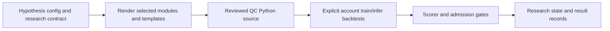

# Current source design and operations

Reviewed 2026-11-07 against pyproject.toml, paths.py, cli.py, harness/constants.py, harness/orchestrator.py, harness/qc_client.py, metrics.py, templates/modules and the tests. Package metadata 0.1.1 is independent of the stale module __version__ string (0.1.0).

## Configuration, paths and API behavior

Paths derive the checkout root from src/lb/paths.py, unless LB_ROOT overrides it. Templates/modules resolve inside that root; scripts, knowledge.json, hypotheses.json and results remain outside the installed package. A normal wheel installation without the checkout layout is not a tested standalone deployment. QC_CREDS_PATH resolves to qc/.creds.json and the API client reads JSON keys user_id and token. This differs from qc_work's qc_user_id/qc_api_token environment/private-file loader. Keep credential files private, excluded from Git, and never copy values into rendered source, reports or command arguments. No automatic private-file-permission validation is established by this client's tests.

harness/constants.py defines the core ETF list, train boundary 2021-08-01, validation boundary 2023-08-01 and test boundary 2026-07-01, plus a fixed QC project selection, 30-second polling interval and 300-second budget. Inspect those definitions before any account run; the README's older June test-end claim was stale. Current code is not a generic project-selection CLI. Do not infer account availability or permitted compute from an embedded ID.

The curl/requests client signs requests and attempts requests before curl fallback. Upload/create/retry/timeout behavior is project-specific; it is not qc_work's immutable queue recovery protocol. A time budget or automatic deletion attempt does not prove successful cloud cleanup. Preserve actual backtest IDs and reconcile account state through an authorized workflow on interruption; never rerun a driver merely because local HTTP returned no usable payload.

## Rendering and research boundaries

orchestrator.render_train_config and render_infer_cell/online/live_trade/portfolio generate source from templates and selected modules. Names containing live do not imply an accepted deployable model. Tests render/compile selected fixtures; they do not execute real QC APIs. Changes to activity bars, label clocks, feature availability, cell naming or threshold/sizing can alter identity and leakage behavior; retain the locked scorer and historical gates from program.md rather than optimizing the test window.

Research state and score records are mutable workflow inputs. Use exact source, config, data provenance, time splits, environment and cell identity for any reproducibility claim. An archived best score selected after repeated searches is not untouched prospective evidence. References and private reports omitted from Git cannot be recreated from a score table alone.

## Metrics contract (0.1.1)

Underwater/max-drawdown/Pain/Ulcer/duration helpers accept finite equity curves, with positive starting capital for drawdown helpers; later negative equity remains visible as >100% drawdown. Empty drawdown series preserve zero/empty conventions. Martin ratio requires finite positive periods/year (default 252), returns infinity for growing never-underwater curves, zero for flat curves or the retained undefined/small-input sentinel, and a real total-loss value when terminal equity is zero. Negative terminal equity uses the undefined-zero sentinel. Zero therefore conflates valid flat and undefined cases; callers needing missingness must retain a separate status. These are reporting conventions, not economic acceptance gates.

## Operations and recovery limits

Offline development uses the 19 tests and compileall from CI.md. Do not invoke lb-round or round-driver help to validate documentation: cli.py dispatches the driver directly. Importing arbitrary research scripts can also execute work. Account runs require deliberately scoped configuration and ownership of source, ObjectStore keys and remote backtests; testing/this documentation is not that authorization.

No automatic production backup, general state rollback, model compatibility migration or account cleanup guarantee is provided. Preserve research JSON/CSV/model/config and remote IDs together before a scoped run. Restoring a single knowledge.json file cannot undo remote uploads or establish which trained model produced an inference result. Keep data licensing/provenance with the provider-owned input release. Project-native runtime/data is private; CI generates only temporary/synthetic fixtures.

## Historical material and future work

program.md retains research selection and scorer boundaries plus dated campaign findings. docs/analysis and docs/legacy retain original dates/results; DEPLOYMENT.md is a historical model discussion, not current deployment permission. docs/research contains technique and data/workflow specifications, some requiring omitted references. See the full inventory for source-review/disposition scope. Remaining gaps include fully pinned research environments, complete private-data replay, broad numerical/cloud parity, prospectively held evaluation, and a general operational state/recovery contract. No live-readiness claim follows from this documentation or unit success.
